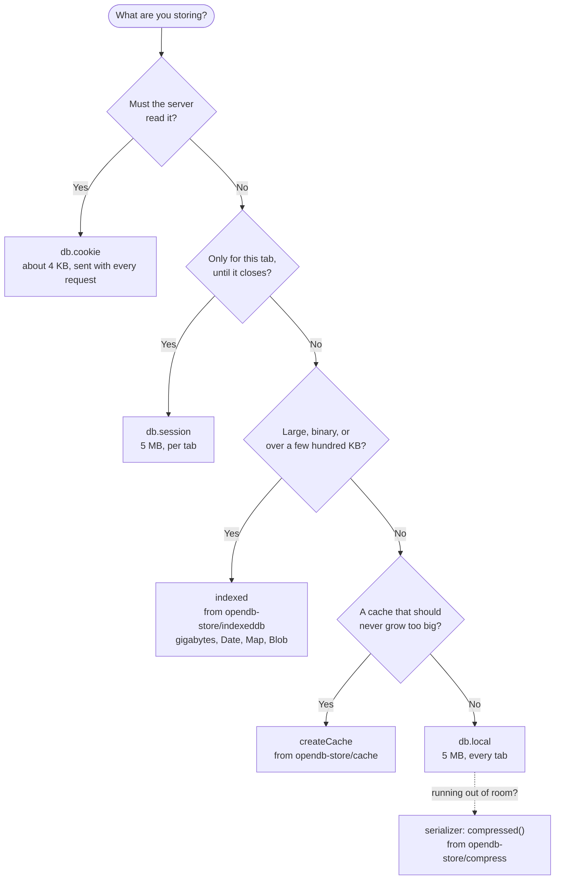
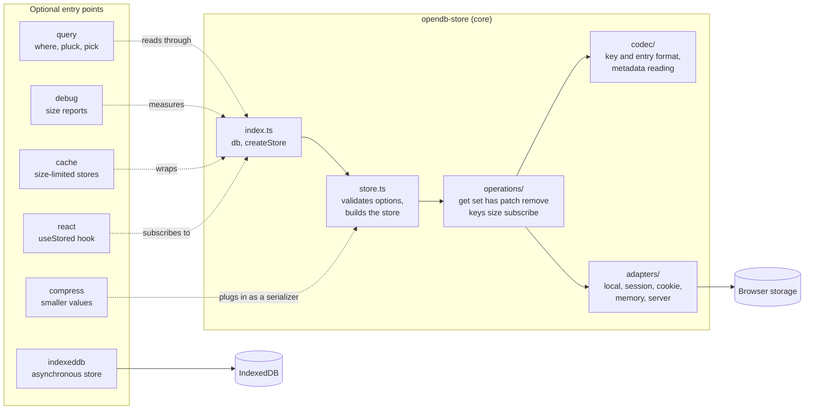
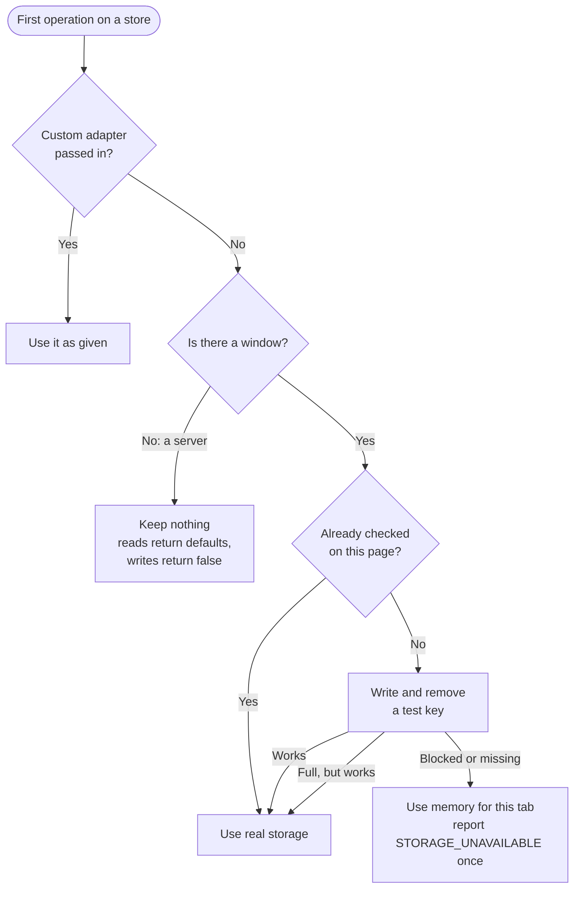
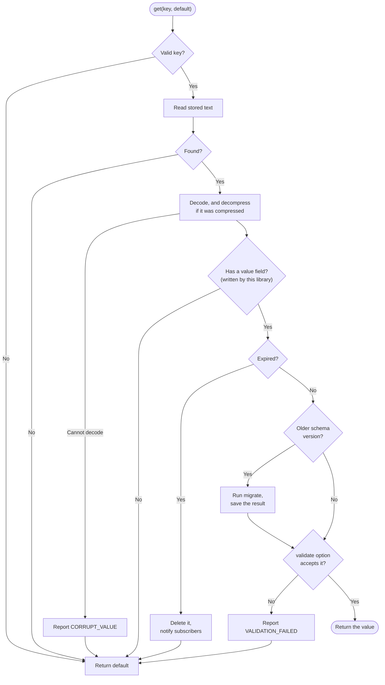
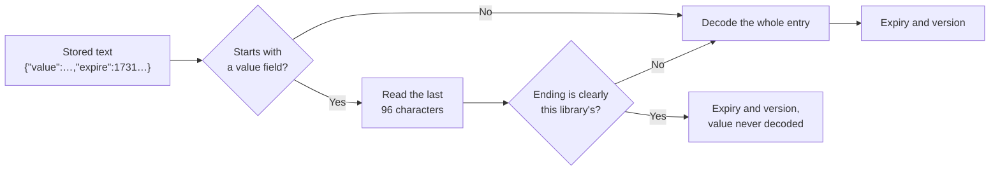
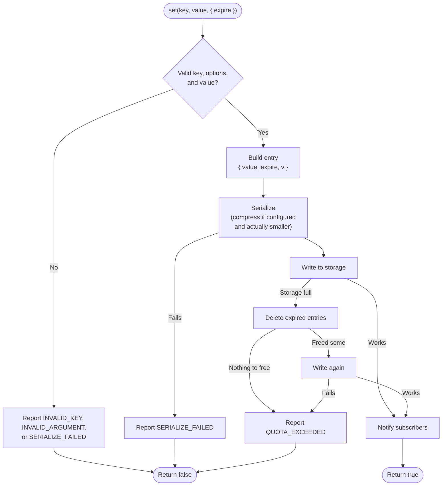
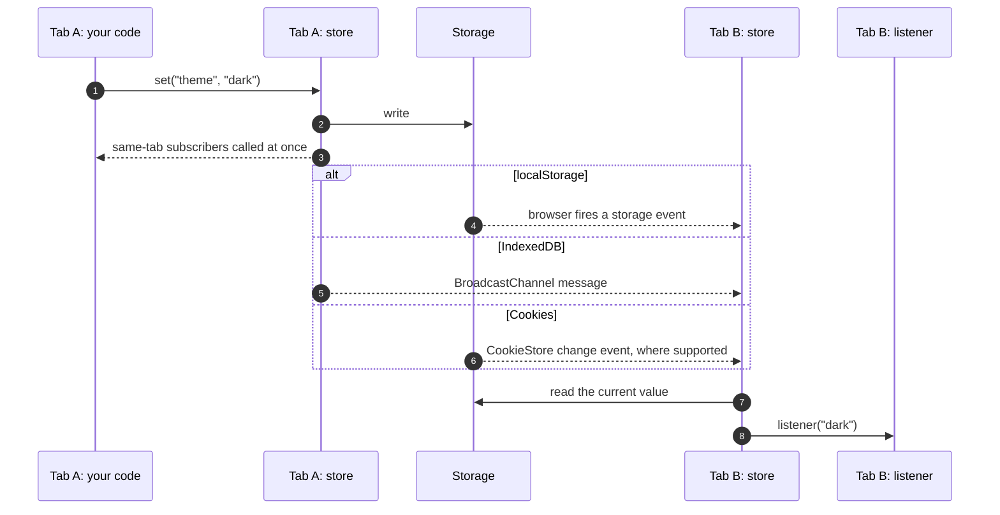
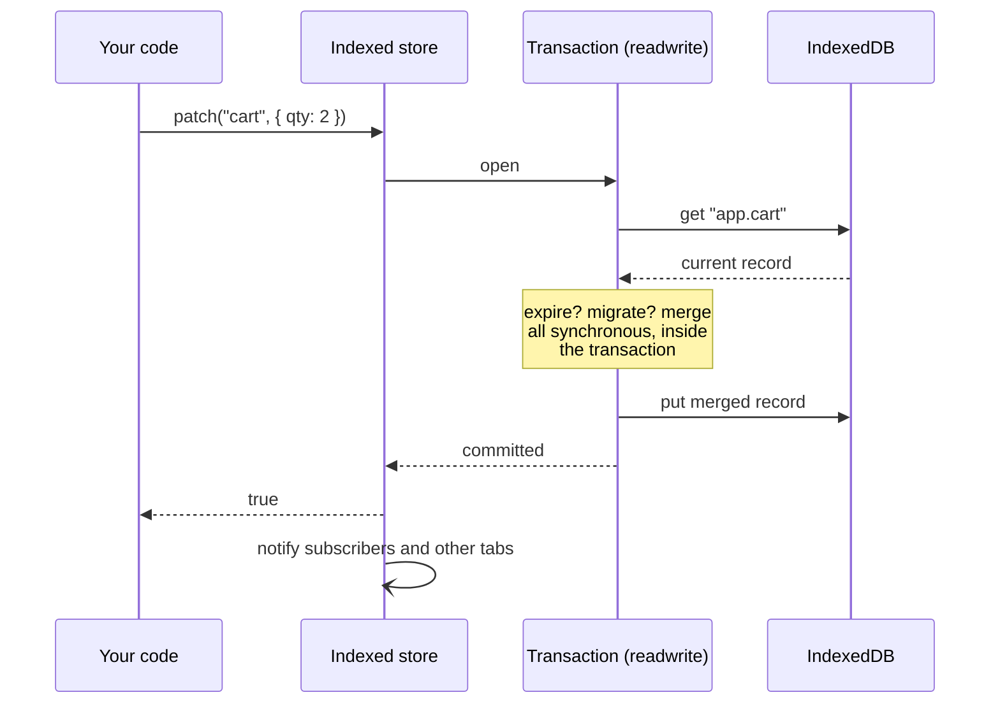
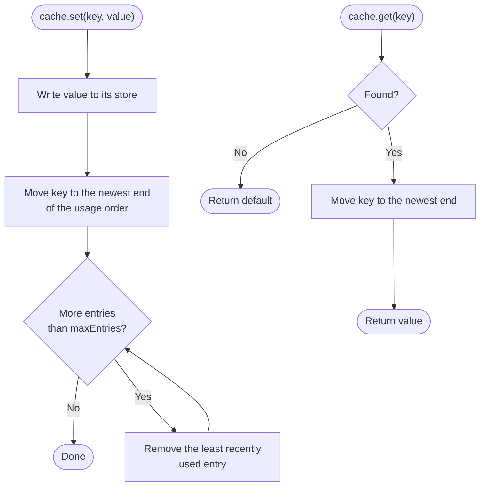
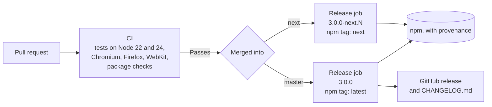

# How opendb-store works

Visual guides to the library. GitHub renders these diagrams directly. In an editor, use a Mermaid preview.

1. [Which store should I use?](#1-which-store-should-i-use)
2. [How the package fits together](#2-how-the-package-fits-together)
3. [Choosing where data lives](#3-choosing-where-data-lives)
4. [Reading a value](#4-reading-a-value)
5. [Listing without decoding](#5-listing-without-decoding)
6. [Writing a value](#6-writing-a-value)
7. [Change notifications](#7-change-notifications)
8. [IndexedDB: an atomic patch](#8-indexeddb-an-atomic-patch)
9. [Least-recently-used cache](#9-least-recently-used-cache)
10. [From commit to npm](#10-from-commit-to-npm)

## 1. Which store should I use?

## 2. How the package fits together

Each optional entry point is a separate import, so it adds nothing for people who do not use it.

## 3. Choosing where data lives

This runs once, on a store's first operation. Creating a store touches nothing.

A server keeps nothing because memory shared by the whole process would let one visitor's data reach another.

## 4. Reading a value

`get(key, default)` on a local, session, or cookie store.

## 5. Listing without decoding

`keys`, `count`, `has`, `ttl`, `size`, and `purgeExpired` only need each entry's expiry. Entries are always written
with metadata last, so it can be read from the end of the text.

When it is not certain, it decodes the whole entry, so this shortcut can only save time. It never changes an answer.

## 6. Writing a value

Operations never throw. Every failure reaches `onError`, or `console.warn` when no handler is set.

## 7. Change notifications

For local, session, and cookie stores, a listener is only called when the stored text actually changed. A listener
that writes its own key is not called again for that write.

## 8. IndexedDB: an atomic patch

Read and write happen in one transaction, so concurrent patches cannot overwrite each other.

A write resolves only after the transaction commits, because browsers can report a full disk at commit time.

## 9. Least-recently-used cache

## 10. From commit to npm

The release job installs without running dependency scripts, checks the package again before publishing, and
signs it with npm provenance.
